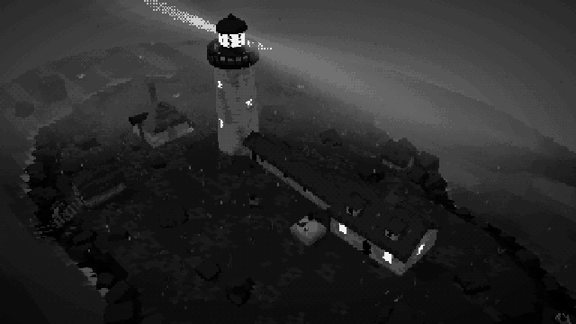

# lighthouse

A rock in the sea, a light, two keepers, and something pale out at the east point. A small game in black and white.

**Play it: [mxz.sh/lighthouse](https://mxz.sh/lighthouse/)**

[](video/lighthouse.mp4)

The same clip in full size and with sound: [video/lighthouse.mp4](video/lighthouse.mp4).

## Controls

| | Keyboard and mouse | Phone |
|---|---|---|
| Roam the rock | `WASD` or arrows, or hold the mouse down | drag a thumb |
| Tread soft | `Shift` | drag only a little |
| Look about | `Q` / `E` | the two stone arrows |
| Peer close | mouse wheel | pinch |
| Have a smoke | `C` | the third stone button |
| Stop your ears | `M` | "stop yer ears" in the row of hints |
| The ledger (volume, credits) | `Esc` | "the ledger" in the row of hints |

## How it is made

- The whole game is one self-contained page, `index.html`. Nothing is loaded after it: no server, no assets, no libraries fetched at run time.
- The world is modelled as solids given by distance functions and baked into about 80,000 small soft points (splats) with [ink-studio](https://github.com/siliconjungle/shapeshift-labs-ink-studio).
- It is drawn by a software renderer in plain JavaScript, with no WebGL, at about 238 × 200 pixels, and then shown large.
- All of the sound is synthesised in the page as it plays.

| File | What it is |
|---|---|
| `level.js` | the rock and everything on it, the two men and how they move, the smoke |
| `game.js` | the page's side: input, camera, the days, the ledger, the count in the corner |
| `sound.js` | wind, sea, the horn, the music, the voices |
| `fast-render.js` | the toolkit's renderer, patched to draw the same picture in less time |
| `build.js` | packs all of it into `index.html`, and writes `changelog.html` and `licenses.txt` |
| `log.js` | the log of what was done, shown at [mxz.sh/lighthouse/changelog.html](https://mxz.sh/lighthouse/changelog.html) |
| `icons.js`, `card.js` | the stone buttons, the link picture and the tab icon, drawn the same way the level is |
| `shot.js` | renders a still of the level from Node, without a browser |

## Build

It needs Node and a copy of the toolkit. It was built against ink-studio at commit `b86f00a`.

```sh
git clone https://github.com/siliconjungle/shapeshift-labs-ink-studio
git -C shapeshift-labs-ink-studio checkout b86f00a
node build.js --repo shapeshift-labs-ink-studio
```

That writes `index.html`; open it in a browser. A still without a browser:

```sh
node shot.js out.png --repo shapeshift-labs-ink-studio
```

## Credits

- Made by [@maxeozakh](https://x.com/maxeozakh).
- Drawn with [ink-studio](https://github.com/siliconjungle/shapeshift-labs-ink-studio), by [@JungleSilicon](https://x.com/JungleSilicon).
- Set in [Redaction](https://www.redaction.us/), by Forest Young and Jeremy Mickel.

The licences of the toolkit (MIT) and the type (SIL Open Font License) are in `licenses.txt`.
